# Module 5 Practice Exercise Outputs

This page shows the rendered outputs of the 20 Module 5 practice exercises.

## Easy Exercises

### Exercise Q01 - VBO X-Pattern Points

Convert an immediate-mode GL_POINTS block (5 points forming an X pattern with a center point) into a VBO, using all 5 steps (generate, bind, upload, point-and-draw with an offset, clean up).

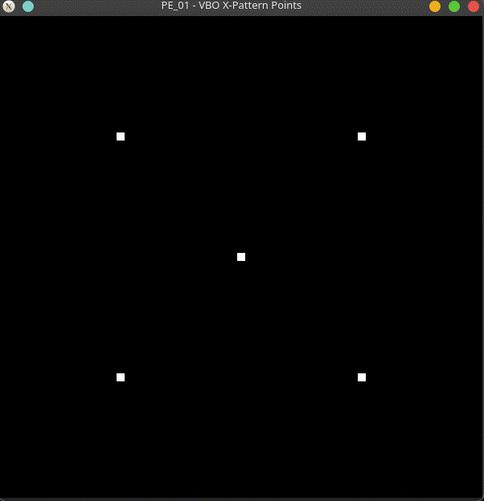

[Source code](SERRANO_PE_01.cpp)

### Exercise Q02 - VBO Line Loop Square

Draw the outline of a square using GL_LINE_LOOP via a VBO, with 4 unique vertices of your own choosing.

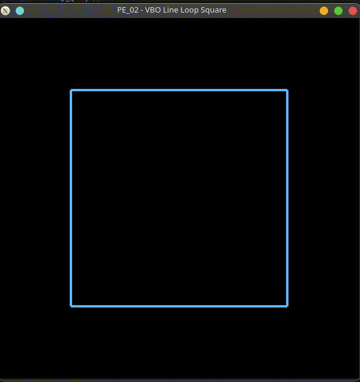

[Source code](SERRANO_PE_02.cpp)

### Exercise Q03 - Static Hexagon With the Correct Usage Hint

Draw a filled, six-sided hexagon using GL_POLYGON via a VBO, choosing the usage hint that best matches data uploaded once and drawn many times, and add a code comment explaining WHY you chose it.

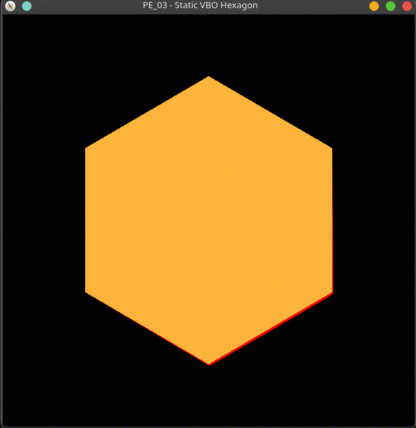

[Source code](SERRANO_PE_03.cpp)

### Exercise Q04 - Full Cleanup Checklist

Draw any simple shape from a VBO, and BEFORE the program exits, perform the full cleanup checklist: glDisableClientState, glBindBuffer(target, 0), and glDeleteBuffers, with a comment above each line explaining what it undoes.

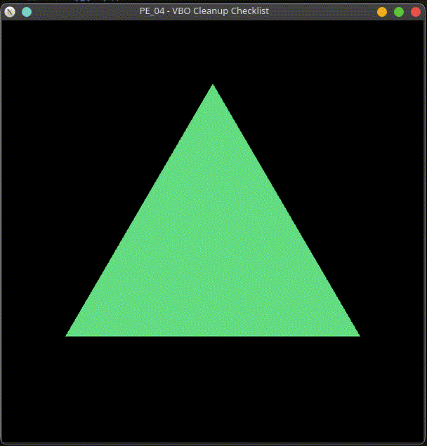

[Source code](SERRANO_PE_04.cpp)

### Exercise Q05 - Two Separate VBOs Side by Side

Draw two triangles side by side, each one sourced from its OWN separate VBO (two GLuint IDs, two glGenBuffers/glBindBuffer/glBufferData sequences).

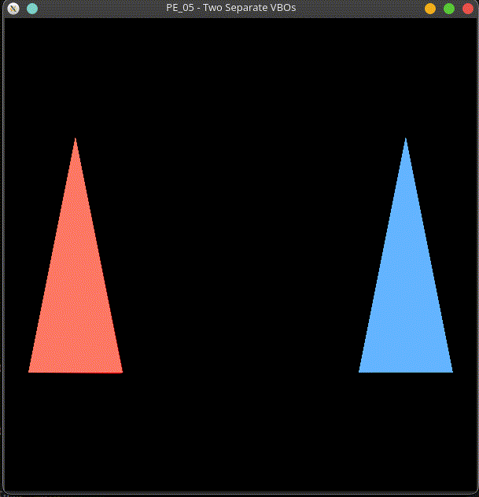

[Source code](SERRANO_PE_05.cpp)

### Exercise Q06 - Flat-Colored VBO Quad

Convert an immediate-mode filled square into a VBO using GL_QUADS, keeping a single flat glColor3f color for the whole shape (no color array needed yet).

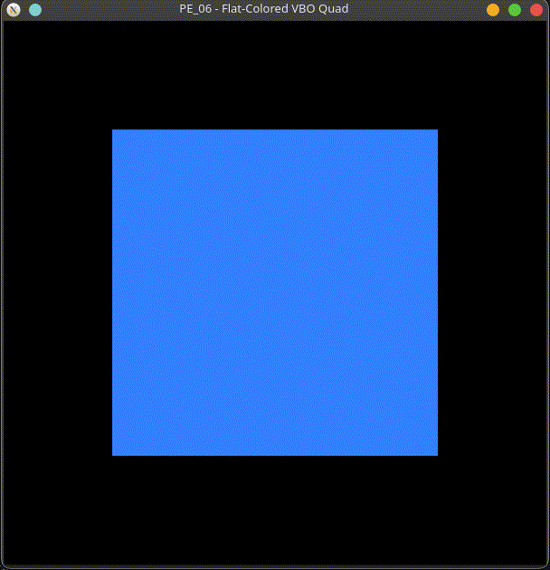

[Source code](SERRANO_PE_06.cpp)

### Exercise Q07 - VBO Line-Strip Zigzag

Draw a zigzag line (at least 5 vertices) using GL_LINE_STRIP via a VBO.

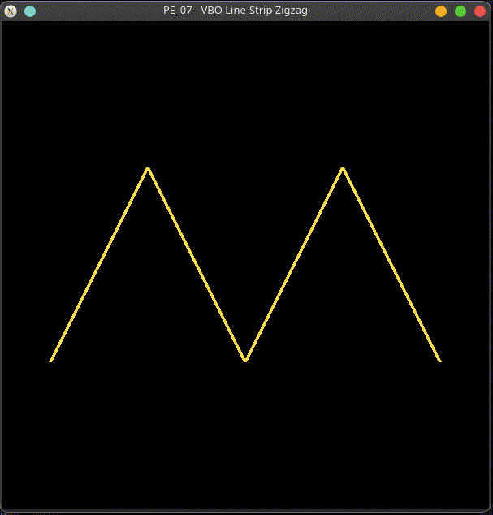

[Source code](SERRANO_PE_07.cpp)

## Medium Exercises

### Exercise Q08 - Indexed Quad: Position VBO + Separate Index VBO

Build a quad from 4 unique GPU-resident vertices plus a 6-entry GPU-resident index buffer, drawn with glDrawElements.

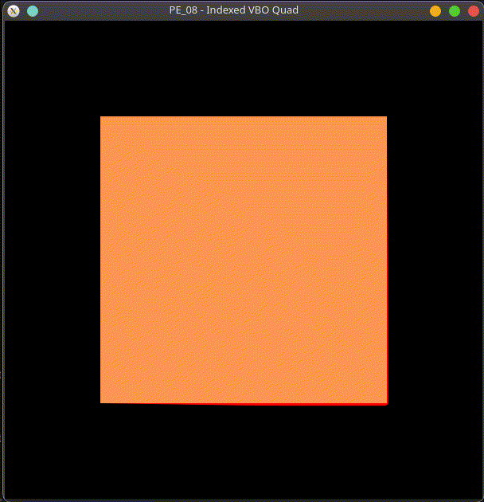

[Source code](SERRANO_PE_08.cpp)

### Exercise Q09 - Two-VBO Colored Triangle

Draw a triangle with a different color at each vertex, using a position VBO and a separate color VBO (two independent buffers, not one interleaved buffer).

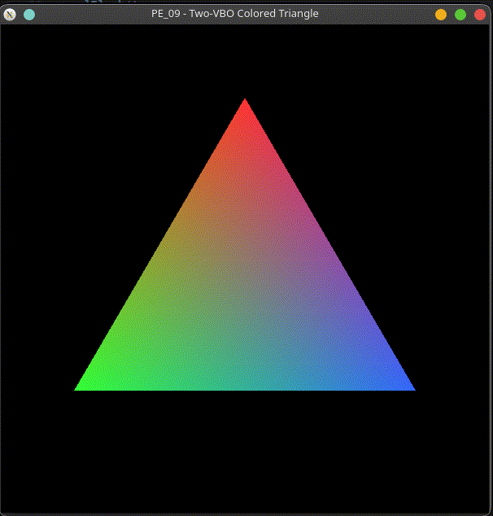

[Source code](SERRANO_PE_09.cpp)

### Exercise Q10 - Interleaved VBO Quad

Build a single interleaved VBO holding both position and color data for a quad (like Example 12), and render it using stride-based glVertexPointer/glColorPointer calls.

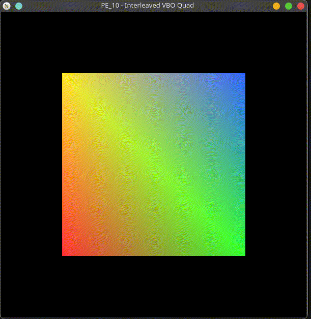

[Source code](SERRANO_PE_10.cpp)

### Exercise Q11 - One-Shot glMapBuffer Vertical Shift

Draw a triangle from a VBO, then use glMapBuffer(GL_ARRAY_BUFFER, GL_READ_WRITE) to shift ONE vertex upward by editing the mapped memory directly, calling glUnmapBuffer before the draw call.

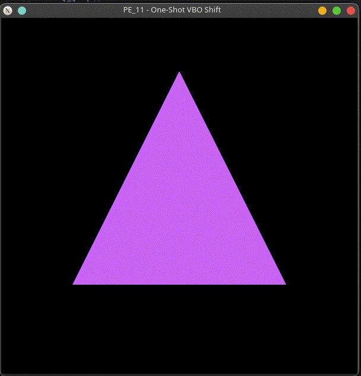

[Source code](SERRANO_PE_11.cpp)

### Exercise Q12 - Timer + glMapBuffer Moving Point

Animate a single GL_POINTS vertex so it moves one step to the right every second, using a glutTimerFunc callback that maps the VBO, updates the x-coordinate, unmaps it, and reschedules itself.

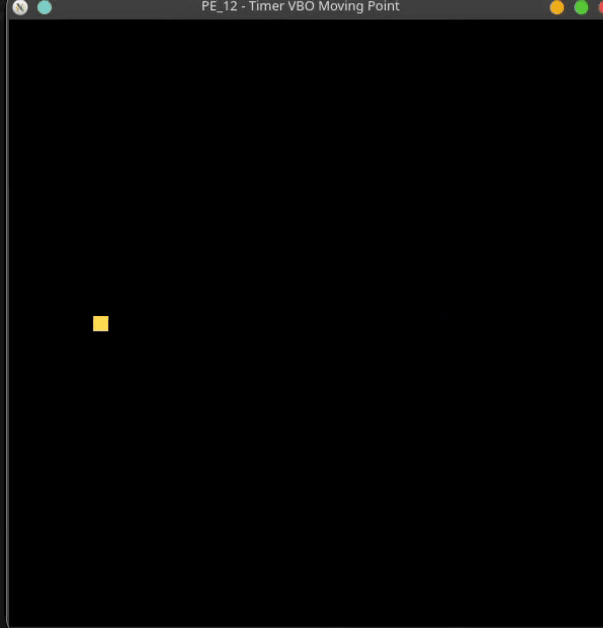

[Source code](SERRANO_PE_12.cpp)

### Exercise Q13 - ESC Cleanup Releasing Two VBOs

Draw a scene using two separate VBOs, and write a monitorKeyboard() handler that releases BOTH buffers with glDeleteBuffers before exit(0) when ESC is pressed.

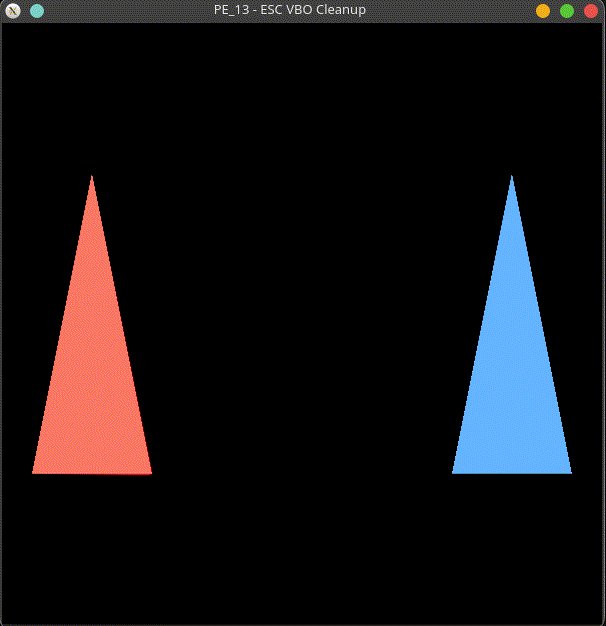

[Source code](SERRANO_PE_13.cpp)

### Exercise Q14 - Indexed GL_TRIANGLE_FAN Pentagon

Build a pentagon from GL_TRIANGLE_FAN using glDrawElements with GPU-resident position and index buffers, where the shared center vertex is stored only ONCE.

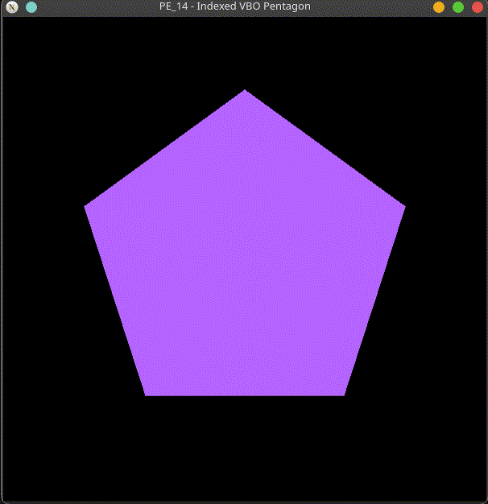

[Source code](SERRANO_PE_14.cpp)

## Hard Exercises

### Exercise Q15 - Continuous Bouncing glMapBuffer Animation

Animate a quad's height so it bounces up and down continuously (reversing direction at top and bottom limits), using glutTimerFunc to repeatedly map, edit, and unmap its VBO.

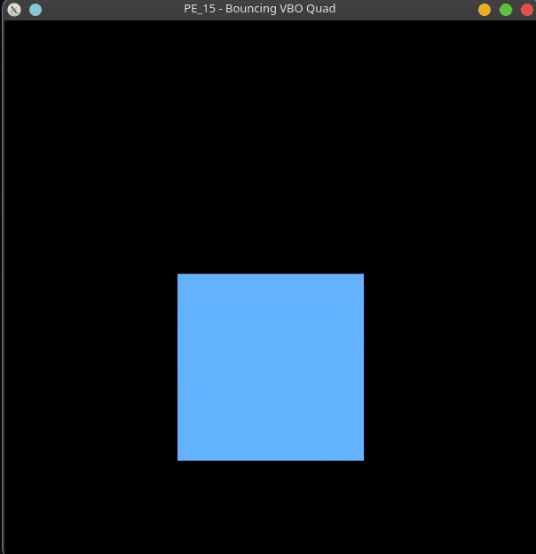

[Source code](SERRANO_PE_15.cpp)

### Exercise Q16 - Three-Shape VBO Scene: Sun, Indexed Ground, Tree

Build a scene with at least 3 shapes (e.g., a sun, a ground rectangle, and a tree) where EVERY shape is sourced from a VBO, mixing glDrawArrays and glDrawElements as appropriate, and the ground uses an indexed element buffer.

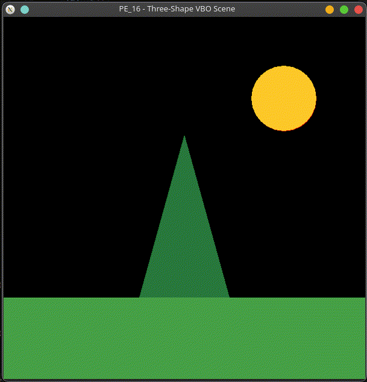

[Source code](SERRANO_PE_16.cpp)

### Exercise Q17 - Procedural 30-Dash Ring in One VBO

Generate 30 short dash segments arranged in a ring (using sinf/cosf in a loop) and upload them all into a SINGLE VBO, rendered with one GL_LINES glDrawArrays call.

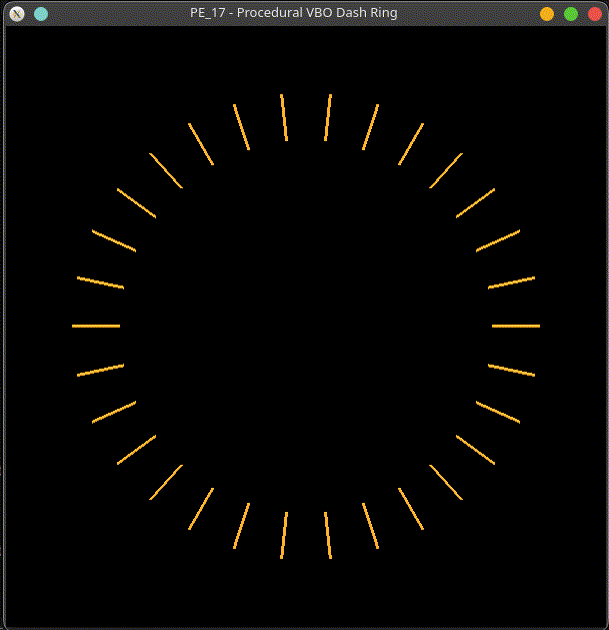

[Source code](SERRANO_PE_17.cpp)

### Exercise Q18 - Interleaved + Indexed Hexagon

Build an interleaved position+color VBO (like Example 12) for a hexagon rendered with glDrawElements AND a non-zero stride, using a separate GPU-resident index buffer.

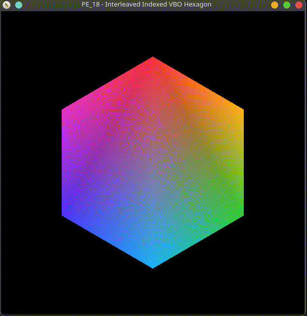

[Source code](SERRANO_PE_18.cpp)

### Exercise Q19 - Keyboard-Triggered Color Change via glMapBuffer

Draw a shape from a position VBO and a color VBO, and use glutKeyboardFunc so pressing the 'c' key maps the COLOR buffer, cycles every vertex to a new color, and unmaps it, updating the display immediately.

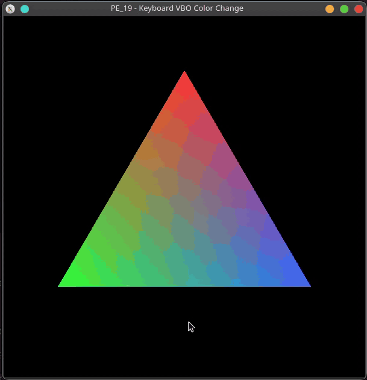

[Source code](SERRANO_PE_19.cpp)

### Exercise Q20 - Capstone: Animated Ship Over Indexed Ground

Build a capstone scene: an animated 'ship' triangle (position+color VBO, moved every second via glutTimerFunc + glMapBuffer), a static indexed ground quad (position VBO + index VBO), and an ESC-key handler that releases all four buffers before exit(0).

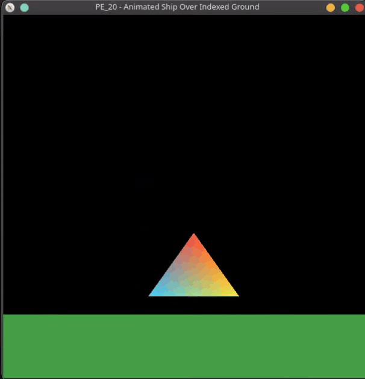

[Source code](SERRANO_PE_20.cpp)
