# Module 6 Practice Exercise Outputs

This page shows the rendered outputs of the 20 Module 6 practice exercises.

## Easy Exercises

### Exercise Q01 - Immediate-Mode 4-Sided Pyramid

Draw a pyramid using glBegin(GL_TRIANGLES) with FOUR side faces (front, right, back, left), giving each face its OWN flat color via one glColor3f() call per face.

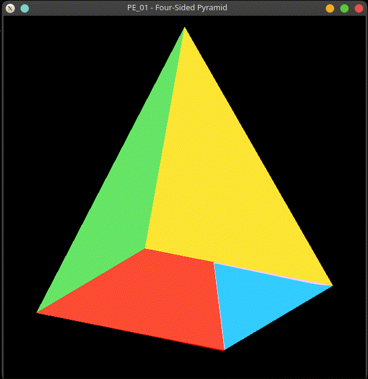

[Source code](SERRANO_PE_01.cpp)

### Exercise Q02 - VBO Conversion of One Cube Face

Convert the cube's TOP face (a GL_QUADS shape) to a VBO using all 5 steps, keeping a single flat glColor3f() color.

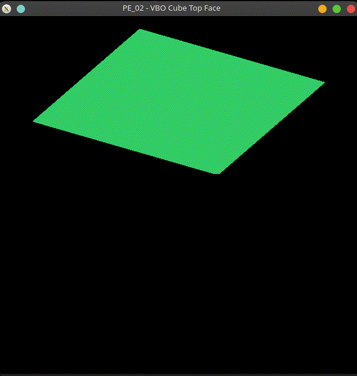

[Source code](SERRANO_PE_02.cpp)

### Exercise Q03 - Scalar Product Matrix, By Hand

Multiply a 2x2 scalar matrix (2.0 on the diagonal) against a single 2D point BY HAND in code, print the before/after values to the console, and draw both points.

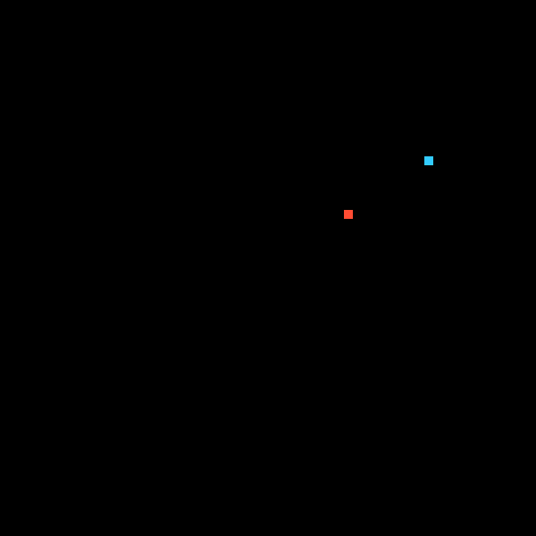

[Source code](SERRANO_PE_03.cpp)

### Exercise Q04 - A Simple translateX() Helper

Write a translateX(float x, int startindex) function that adds x to a mapped vertex's X coordinate ONLY (no full matrix multiply needed), and apply it to every vertex of a VBO triangle via glMapBuffer.

[Source code](SERRANO_PE_04.cpp)

### Exercise Q05 - Matrix Addition, By Hand

Add two 2x2 matrices element by element in code, print the resulting matrix to the console, and draw a simple shape to confirm the program still runs correctly.

[Source code](SERRANO_PE_05.cpp)

### Exercise Q06 - glBufferSubData for a Colored Line

Draw a GL_LINES segment with two different-colored endpoints, reserving space with ONE glBufferData(NULL) call and uploading position data and color data with TWO separate glBufferSubData() calls.

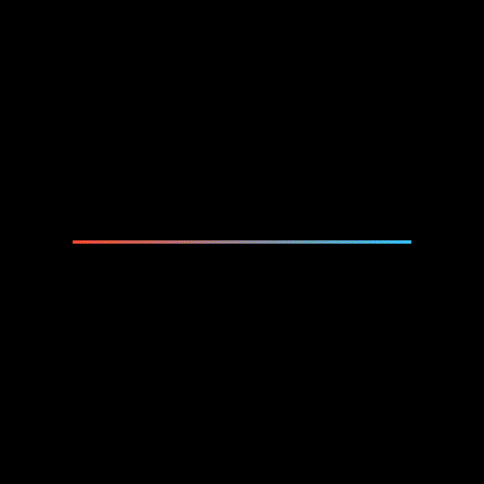

[Source code](SERRANO_PE_06.cpp)

### Exercise Q07 - glArrayElement Basics

Draw a triangle using THREE hand-typed glArrayElement() calls inside glBegin(GL_TRIANGLES)/glEnd(), with position data sourced from a VBO.

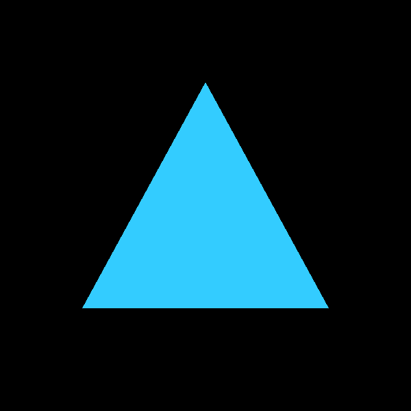

[Source code](SERRANO_PE_07.cpp)

## Medium Exercises

### Exercise Q08 - scale() Applied to Every Vertex of a Shape

Write a scaleAll() matrix function (following the lecture's Scaling matrix template) and apply it, in a loop, to every vertex of a VBO quad, doubling its size before the first draw.

[Source code](SERRANO_PE_08.cpp)

### Exercise Q09 - rotateZ() Applied Once

Write a rotateZ() matrix function using the lecture's Rz(theta) template, and apply a ONE-TIME 45-degree rotation to every vertex of a VBO quad before its first draw.

[Source code](SERRANO_PE_09.cpp)

### Exercise Q10 - Combining Translate and Scale

Write a multiply4x4() helper, use it to combine a translation matrix and a scale matrix into ONE matrix, and apply that single combined matrix to every vertex of a triangle.

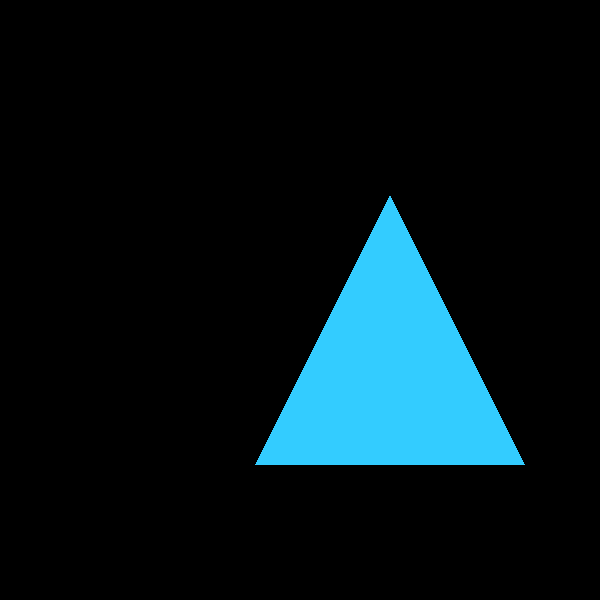

[Source code](SERRANO_PE_10.cpp)

### Exercise Q11 - Color Cube Face via glBufferSubData

Build ONE VBO holding a cube face's position data followed by per-vertex color data (via glBufferSubData), drawn with glColorPointer() + glDrawArrays(GL_QUADS, ...).

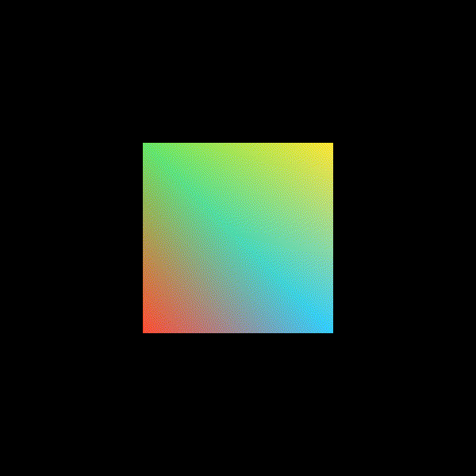

[Source code](SERRANO_PE_11.cpp)

### Exercise Q12 - Timer-Driven translate() Animation

Animate a triangle so it moves UPWARD once per second, using the translate() matrix function and a self-rescheduling glutTimerFunc callback, matching the lecture's modifyPolygon() structure.

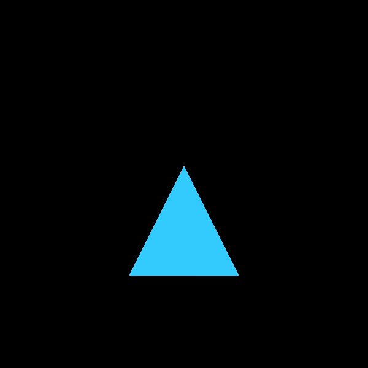

[Source code](SERRANO_PE_12.cpp)

### Exercise Q13 - Rotation and Homogeneous Coordinates

Apply the SAME rotateZ() function to both a position (w=1) and a direction (w=0), print both results to the console, and explain in a code comment why rotation affects w=0 vectors when translation does not.

[Source code](SERRANO_PE_13.cpp)

### Exercise Q14 - glArrayElement in a Loop, Five Colors

Draw a 5-vertex colored pentagon using glArrayElement() inside a for loop (not hand-typed calls), with position and color both uploaded via glBufferSubData.

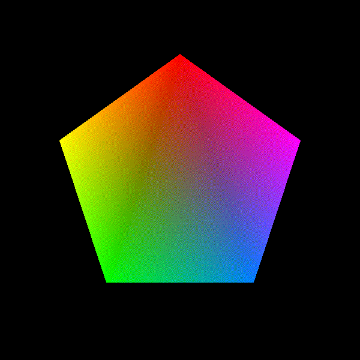

[Source code](SERRANO_PE_14.cpp)

## Hard Exercises

### Exercise Q15 - Scaled-Then-Animated Color Cube

Build a three-face color cube (combined position+color VBO via glBufferSubData) that is scaled down by half ONCE at startup, then drifts diagonally once per second using translate().

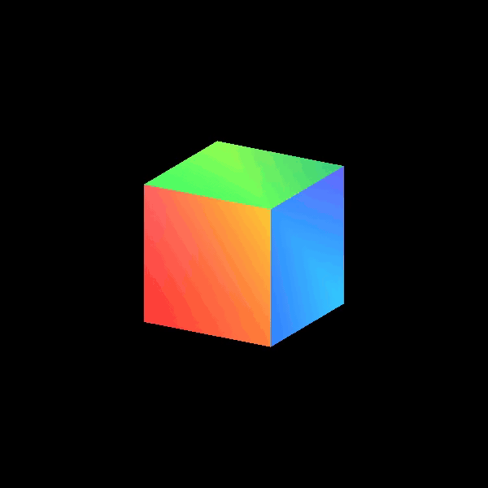

[Source code](SERRANO_PE_15.cpp)

### Exercise Q16 - Toggleable Face Culling

Draw two triangles with opposite winding order, and use glutKeyboardFunc so pressing 'f' toggles GL_CULL_FACE on and off, letting the viewer SEE the clockwise triangle appear and disappear.

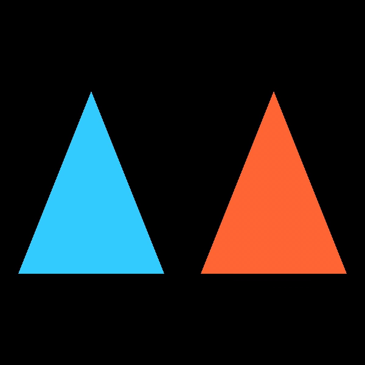

[Source code](SERRANO_PE_16.cpp)

### Exercise Q17 - Triggering the Error Callback

Register a glDebugMessageCallback exactly as in Example 16, then deliberately call an OpenGL function with an INVALID enum (something guaranteed to be wrong) so the callback fires and prints a diagnostic message.

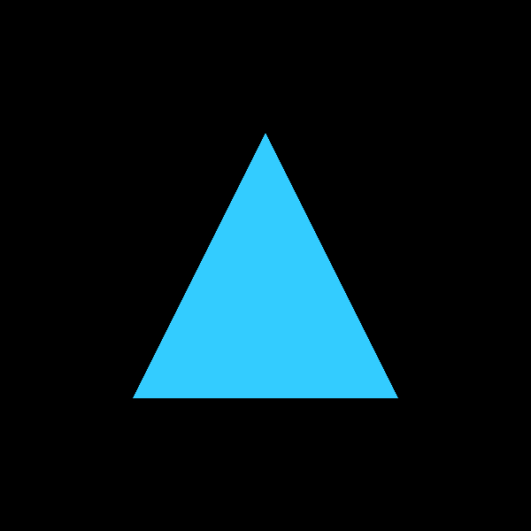

[Source code](SERRANO_PE_17.cpp)

### Exercise Q18 - Two Shapes, One Combined Buffer

Combine a pyramid face's position+color data AND a cube face's position+color data into ONE VBO (four glBufferSubData calls total), and draw both shapes with two separate glDrawArrays calls using different vertex/color pointer offsets.

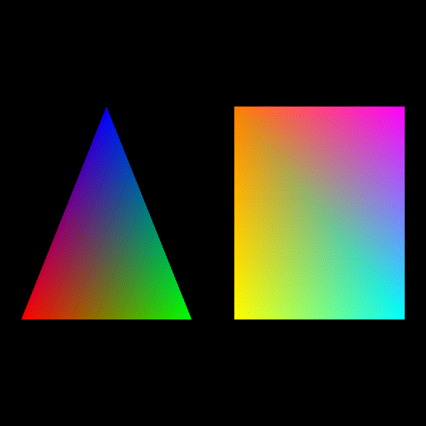

[Source code](SERRANO_PE_18.cpp)

### Exercise Q19 - Continuous Y-Axis Rotation With Cleanup

Continuously rotate a colored quad around the Y axis using rotateY(), once per second via glutTimerFunc, with a monitorKeyboard() ESC handler that releases the VBO before exit(0).

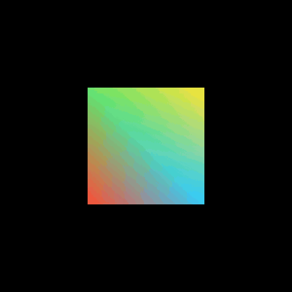

[Source code](SERRANO_PE_19.cpp)

### Exercise Q20 - Capstone: Rotating and Drifting Color Cube

Build a three-face color cube (combined position+color VBO) that BOTH rotates around Z and drifts diagonally every second (applying rotateZ() then translate() to each vertex inside one timer callback), with ESC-key cleanup releasing the buffer.

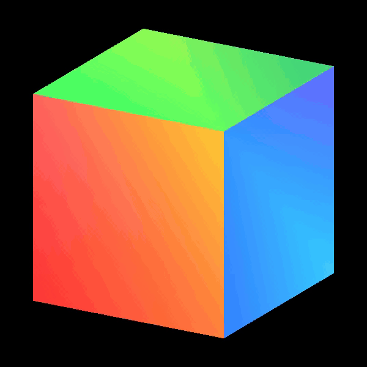

[Source code](SERRANO_PE_20.cpp)
