# Module 7 Practice Exercise Outputs

This page shows the rendered outputs of the 20 Module 7 practice exercises.

## Easy Exercises

### Exercise Q01 - Translate a Square Upward

Move a square UP by 0.4 units using glTranslatef(), starting from glLoadIdentity().

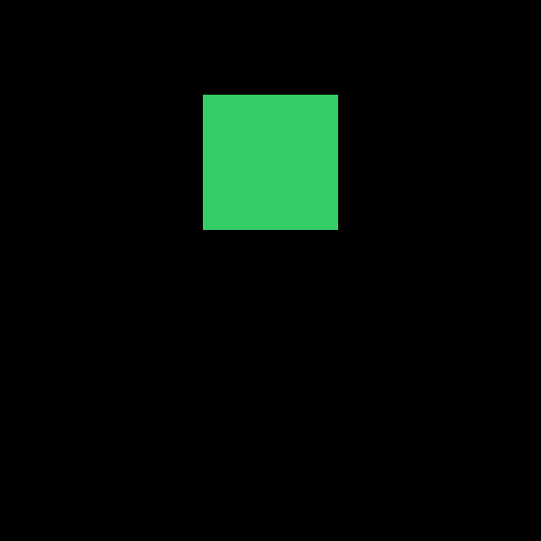

[Source code](SERRANO_PE_01.cpp)

### Exercise Q02 - Rotate Around the X Axis

Rotate a quad 60 degrees around the X axis (not Z) inside a gluPerspective scene, so the "flattening" effect of rotating away from the viewer is visible.

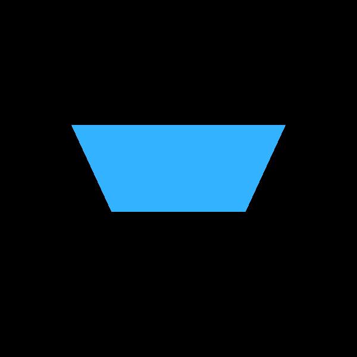

[Source code](SERRANO_PE_02.cpp)

### Exercise Q03 - Non-Uniform Scaling

Scale a square non-uniformly using glScalef() so it becomes a wide, short rectangle (different X and Y scale factors).

[Source code](SERRANO_PE_03.cpp)

### Exercise Q04 - Three Quads, One Rotated

Draw three quads in a row, where only the MIDDLE one is rotated 45 degrees, using glPushMatrix()/glPopMatrix() to keep that rotation from affecting the other two.

[Source code](SERRANO_PE_04.cpp)

### Exercise Q05 - A Non-Symmetric glOrtho Viewing Box

Set up glOrtho with a viewing box from 0 to 4 in X and 0 to 3 in Y (not the usual -1..1), and draw a shape positioned using coordinates that make sense in that range.

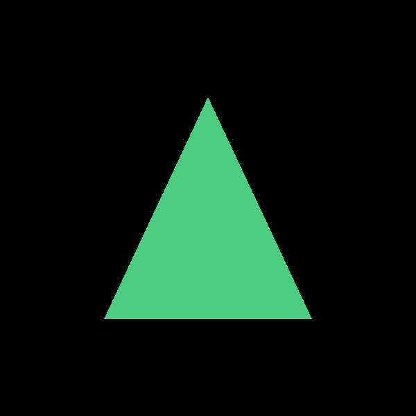

[Source code](SERRANO_PE_05.cpp)

### Exercise Q06 - gluOrtho2D With Pixel-Style Coordinates

Set up gluOrtho2D using coordinates from 0 to 800 in X and 0 to 600 in Y (matching an 800x600 window), and draw a shape positioned using pixel-like numbers.

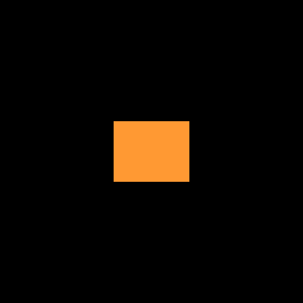

[Source code](SERRANO_PE_06.cpp)

### Exercise Q07 - Animate a Rotating Quad

Animate a quad's rotation angle using a glutTimerFunc callback that increments the angle and wraps it back to 0 after 360 degrees, matching the lecture's animateTriangle() structure.

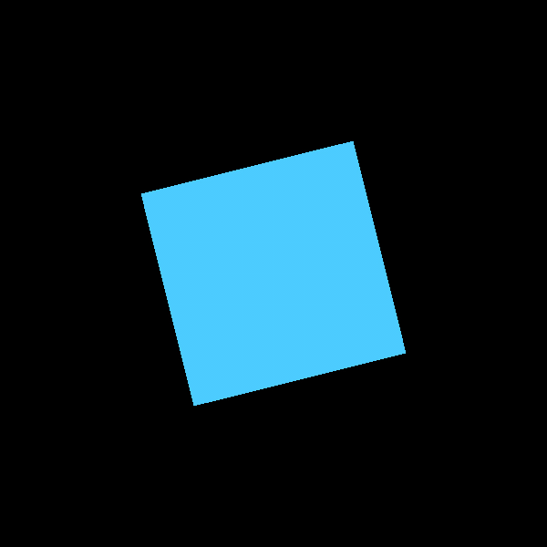

[Source code](SERRANO_PE_07.cpp)

## Medium Exercises

### Exercise Q08 - Scale-Then-Translate vs. Translate-Then-Scale

Draw the SAME square twice: once with translate written before scale in the code, once with scale written before translate, and observe that the translated distance ends up different in each case.

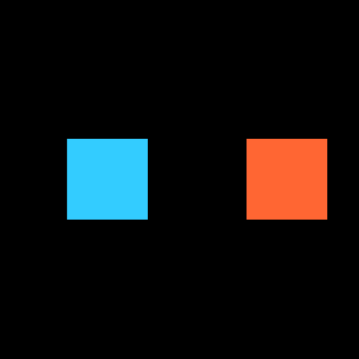

[Source code](SERRANO_PE_08.cpp)

### Exercise Q09 - Three-Segment Hierarchical Chain

Build a three-segment hierarchical chain (base, middle, tip), where each segment has its own local rotation angle and each inherits ALL of its parents' transforms, using nested glPushMatrix()/glPopMatrix() pairs.

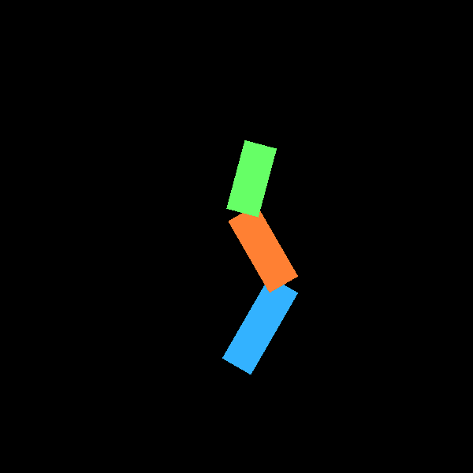

[Source code](SERRANO_PE_09.cpp)

### Exercise Q10 - Comparing Wide vs. Narrow Field of View

Set up a scene where pressing the 'v' key toggles between a WIDE field of view (90 degrees) and a NARROW field of view (30 degrees) via gluPerspective, redrawing the same shape at the same position.

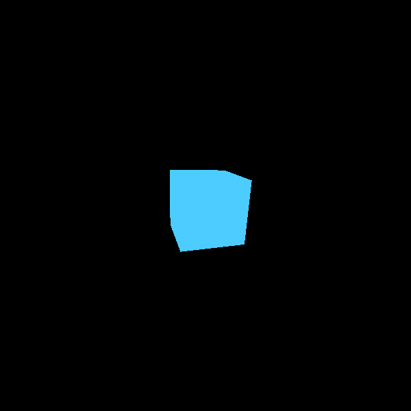

[Source code](SERRANO_PE_10.cpp)

### Exercise Q11 - An Asymmetric glFrustum

Build an asymmetric frustum using glFrustum() (e.g., left = -0.5, right = 1.5) and observe how this shifts the apparent center of the view compared to a symmetric frustum.

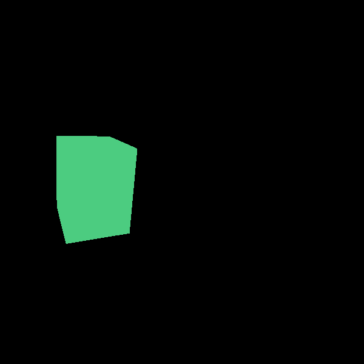

[Source code](SERRANO_PE_11.cpp)

### Exercise Q12 - Orbiting Camera via Animated gluLookAt

Animate the eye position in gluLookAt() so the camera orbits around a fixed quad (using sinf/cosf of an increasing angle), rather than rotating the quad with glRotatef().

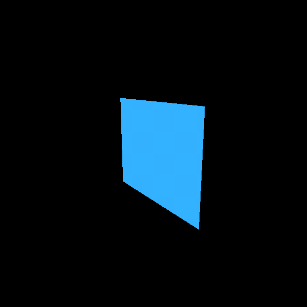

[Source code](SERRANO_PE_12.cpp)

### Exercise Q13 - Static Color Quad via glBufferSubData + glArrayElement

Build a color quad using ONE VBO (position data followed by color data via glBufferSubData), read out with a glArrayElement() loop, following the lecture's displayTriangle() pattern but without any rotation or timer.

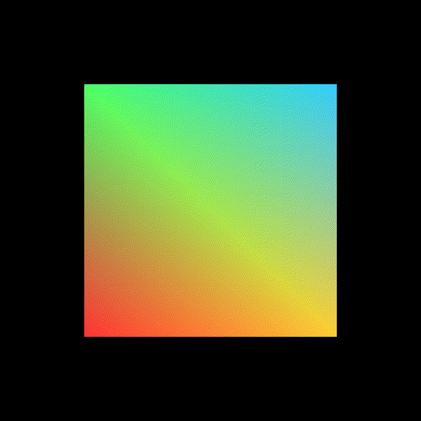

[Source code](SERRANO_PE_13.cpp)

### Exercise Q14 - Depth Testing With Three Triangles

Extend the depth-test comparison to THREE overlapping triangles at different Z depths, toggled on and off with the 'd' key, so students can see all three change draw order at once.

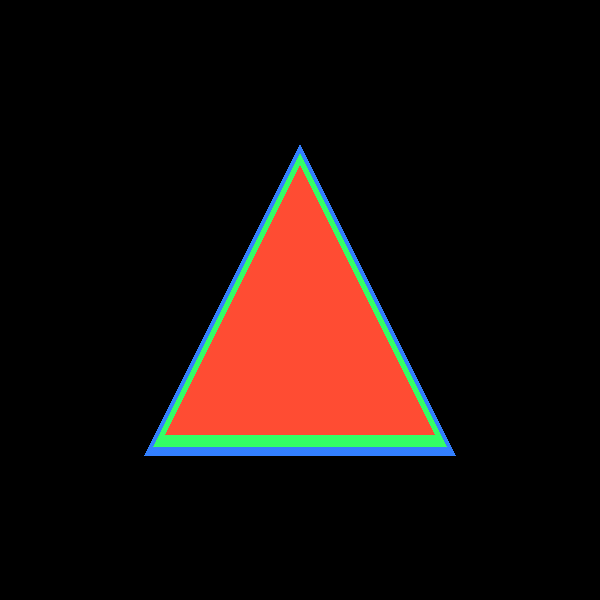

[Source code](SERRANO_PE_14.cpp)

## Hard Exercises

### Exercise Q15 - Lecture Pyramid, Rotated on a Different Axis, With Cleanup

Rebuild the lecture's color pyramid example, but rotate it around the X axis instead of Y, and add a monitorKeyboard() ESC handler that releases the VBO before exit(0).

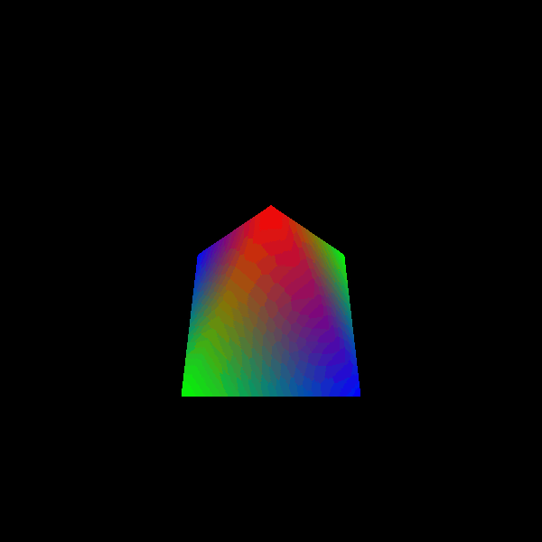

[Source code](SERRANO_PE_15.cpp)

### Exercise Q16 - Split Screen: Orthographic vs. Perspective, Side by Side

Split the window into two viewports showing the SAME 3D shape: orthographic projection on the left, perspective projection on the right, so the difference is directly comparable.

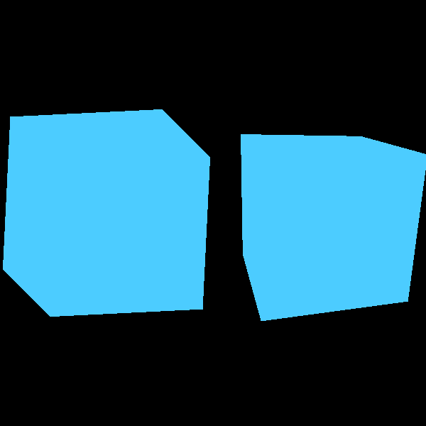

[Source code](SERRANO_PE_16.cpp)

### Exercise Q17 - Error Callback With an Intentional Trigger

Register a glDebugMessageCallback, then intentionally call glEnable with an INVALID enum inside your projection setup function, so the callback fires and prints a diagnostic message before the rest of the scene renders normally.

[Source code](SERRANO_PE_17.cpp)

### Exercise Q18 - Keyboard-Controlled Two-Joint Arm

Build a two-joint arm where the 'a'/'A' keys increase/decrease the base segment's angle and 's'/'S' keys increase/decrease the second joint's angle, using a glPushMatrix()/glPopMatrix() hierarchy so the second joint always inherits the base's current rotation.

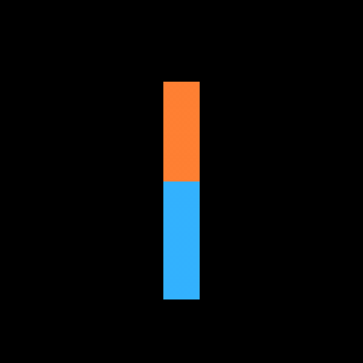

[Source code](SERRANO_PE_18.cpp)

### Exercise Q19 - Two Viewports, Two Cameras, One Animated

Split the window into two viewports showing the SAME 3D scene from two different gluLookAt camera positions at once: the left viewport with a FIXED camera, the right viewport with an ANIMATED orbiting camera.

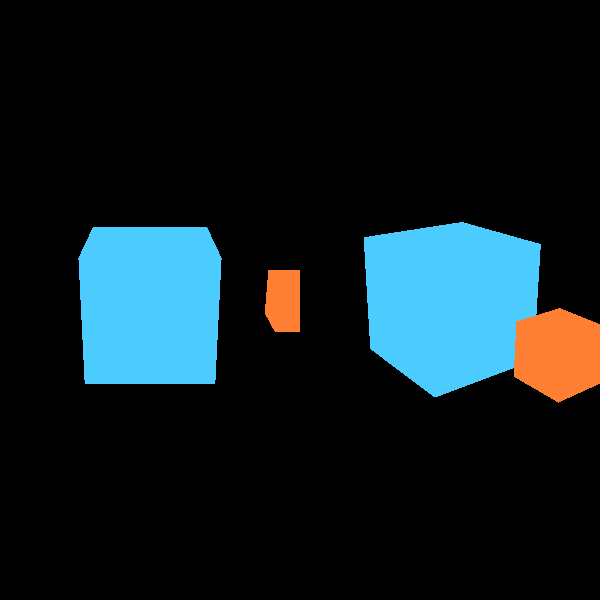

[Source code](SERRANO_PE_19.cpp)

### Exercise Q20 - Capstone: Color VBO Base + Animated Hierarchical Arm

Build a capstone scene: a FIXED color VBO base object (position+color via glBufferSubData, drawn with glArrayElement), with a hierarchical rotating "arm" (glPushMatrix/glPopMatrix, immediate mode) attached above it, both viewed via gluPerspective + gluLookAt, with GLUT_DEPTH, a registered error callback, and ESC-key cleanup that releases the VBO.

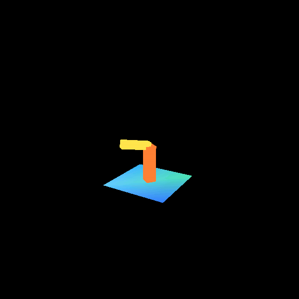

[Source code](SERRANO_PE_20.cpp)
