# Module 8 Practice Exercise Outputs

This page shows the rendered outputs of the 20 Module 8 practice exercises.

## Easy Exercises

### Exercise Q01 - Toggle lighting with the L key

Use glEnable/glDisable(GL_LIGHTING).

[Source code](SERRANO_PE_01.cpp)

### Exercise Q02 - Change ambient intensity

Test .1, .4 and .8 global ambient values.

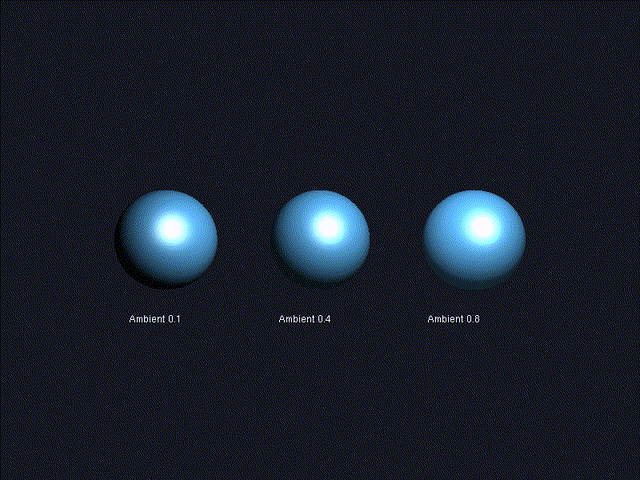

[Source code](SERRANO_PE_02.cpp)

### Exercise Q03 - Red diffuse sphere

Set GL_DIFFUSE material to red.

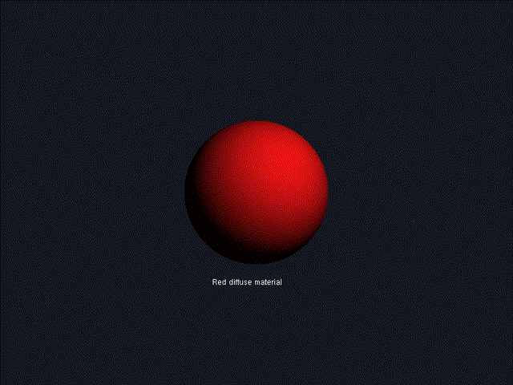

[Source code](SERRANO_PE_03.cpp)

### Exercise Q04 - White specular highlights

Set specular material and light to white.

[Source code](SERRANO_PE_04.cpp)

### Exercise Q05 - Dull versus shiny

Render two spheres with shininess 8 and 96.

[Source code](SERRANO_PE_05.cpp)

### Exercise Q06 - Directional versus point light

Change GL_POSITION w from 0 to 1.

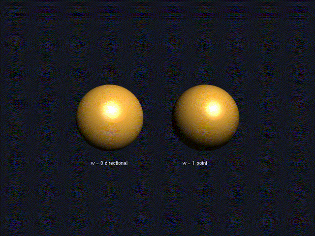

[Source code](SERRANO_PE_06.cpp)

### Exercise Q07 - Generate a texture ID

Create, bind and delete a GL_TEXTURE_2D object.

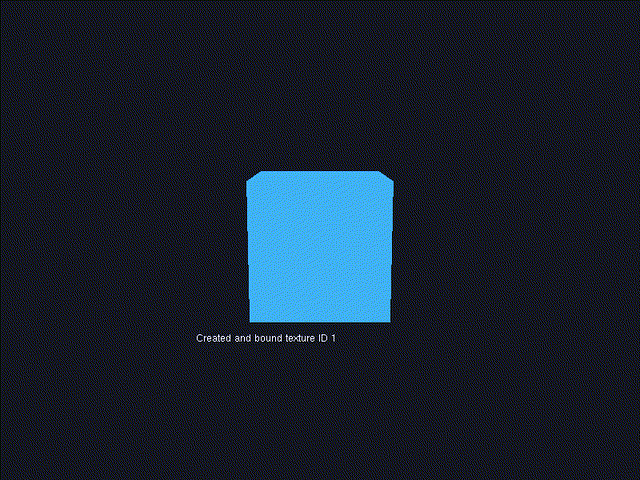

[Source code](SERRANO_PE_07.cpp)

## Medium Exercises

### Exercise Q08 - Move a light with arrow keys

Adjust light x/y coordinates with keyboard callbacks.

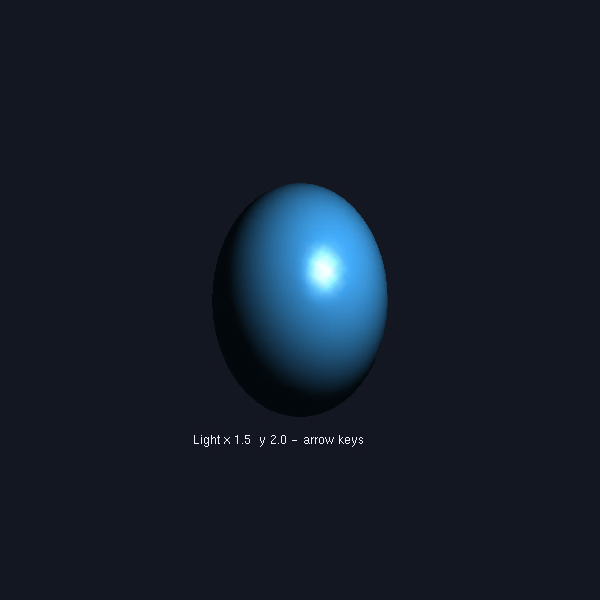

[Source code](SERRANO_PE_08.cpp)

### Exercise Q09 - Colored two-light scene

Enable GL_LIGHT0 and GL_LIGHT1 with different diffuse colors.

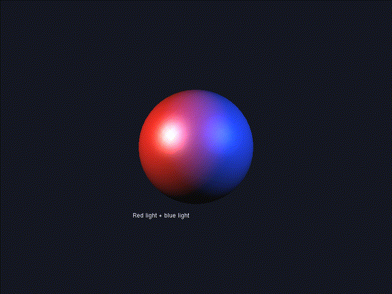

[Source code](SERRANO_PE_09.cpp)

### Exercise Q10 - Attenuation comparison

Render three spheres at increasing distances from a point light.

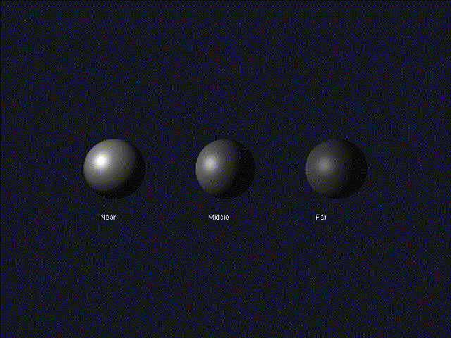

[Source code](SERRANO_PE_10.cpp)

### Exercise Q11 - Spotlight cutoff

Compare 15, 30 and 60 degree cutoffs.

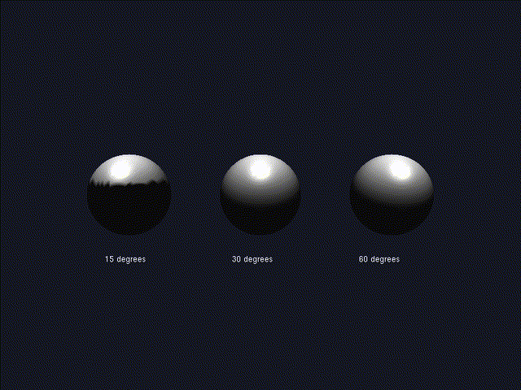

[Source code](SERRANO_PE_11.cpp)

### Exercise Q12 - Front and back materials

Apply different front/back material colors to a rotating polygon.

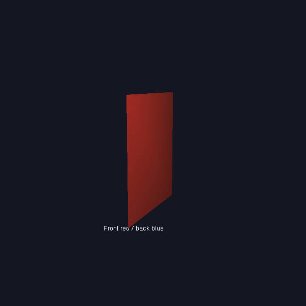

[Source code](SERRANO_PE_12.cpp)

### Exercise Q13 - Checkerboard quad

Upload a procedural RGB checkerboard and map it onto a quad.

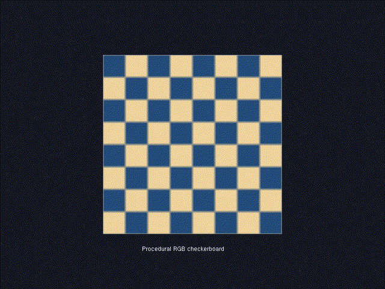

[Source code](SERRANO_PE_13.cpp)

### Exercise Q14 - Texture repeat versus clamp

Compare GL_REPEAT with GL_CLAMP_TO_EDGE using coordinates 0–3.

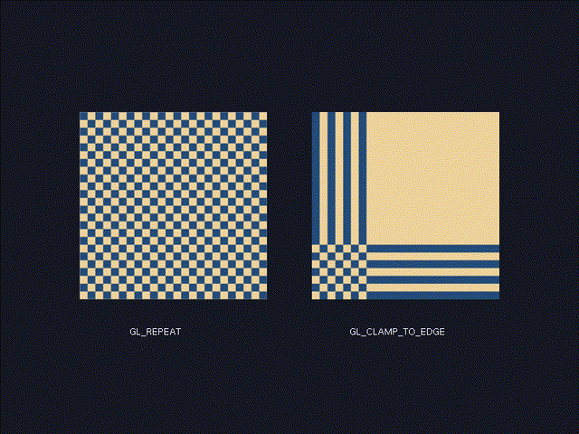

[Source code](SERRANO_PE_14.cpp)

## Hard Exercises

### Exercise Q15 - Textured rotating cube

Map a valid image texture to all six cube faces; animate rotation.

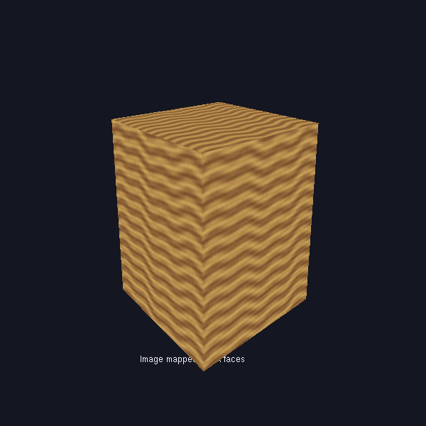

[Source code](SERRANO_PE_15.cpp)

### Exercise Q16 - Wood-textured object

Load woodtexture.jpg using stb_image.h and render a textured cube.

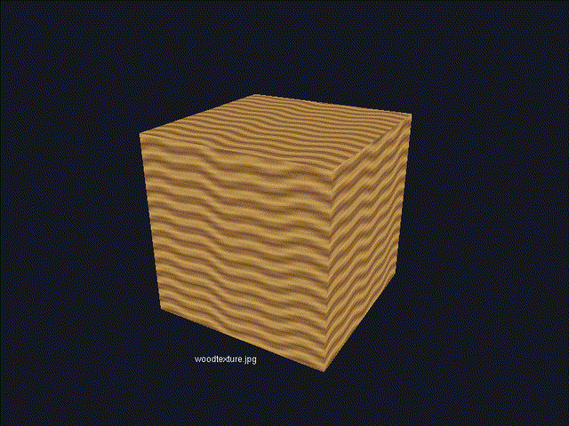

[Source code](SERRANO_PE_16.cpp)

### Exercise Q17 - Lit textured cube

Combine GL_MODULATE, material, normal vectors, light and texture.

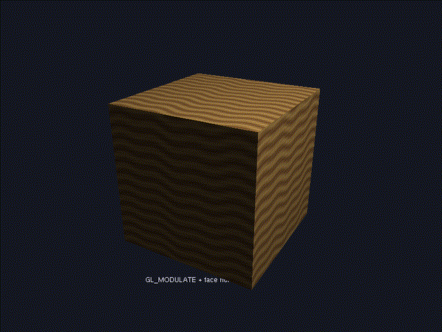

[Source code](SERRANO_PE_17.cpp)

### Exercise Q18 - Texture filtering comparison

Compare GL_NEAREST and GL_LINEAR on an enlarged quad.

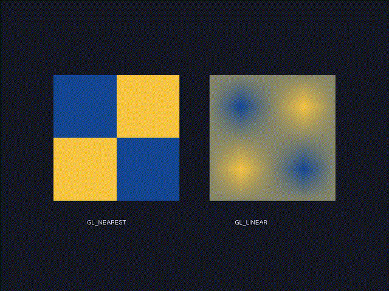

[Source code](SERRANO_PE_18.cpp)

### Exercise Q19 - Two-material showroom

Display a dull object and a shiny object under two lights.

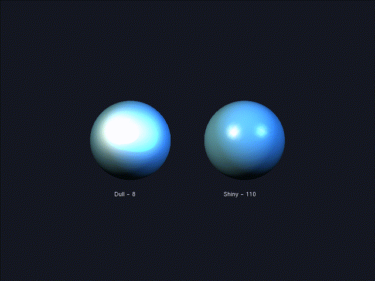

[Source code](SERRANO_PE_19.cpp)

### Exercise Q20 - Mini-scene integration

Create a floor and at least two 3D objects using textures and point/directional lighting.

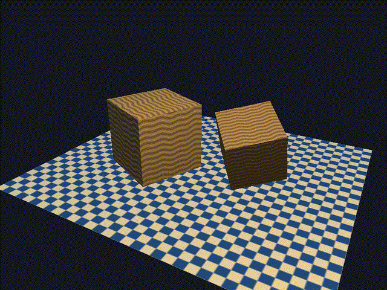

[Source code](SERRANO_PE_20.cpp)
